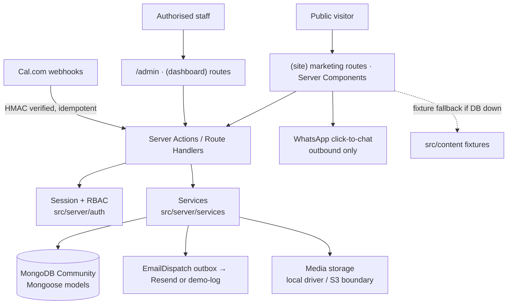

# Architecture

## Overview

One Next.js 16 App Router codebase serves three concerns with clear boundaries:

- **UI** (`src/components`) never touches the database.
- **Server actions** (`src/app/(site)/*/actions.ts`, `src/app/admin/(dashboard)/actions.ts`) validate with Zod, check permissions, then call **services**.
- **Services** (`src/server/services`) hold business rules and side effects (audit, notifications, email).
- **Repositories** (`src/server/repositories/content.ts`) read public content with a typed-fixture fallback and report the `source` (database | fixture) to the dashboard.
- **Models** (`src/server/db/models`) are plain Mongoose schemas; no `server-only` import so seed scripts can reuse them.

## Why MongoDB Community + Mongoose (instead of Prisma/Postgres)

The owner specified MongoDB Community Edition. Consequences handled in code:

- No multi-document transactions on a standalone server → multi-record writes are **ordered** (inquiry → client → lead) and keyed for **idempotency** (`idempotencyKey`, `(provider, externalId)` unique partial index, `reference` unique).
- Text/compound indexes are declared on schemas and synced by `npm run db:seed`.
- Connection is cached across hot reloads (`src/server/db/connect.ts`); `serverSelectionTimeoutMS` keeps failures fast so fixture fallback kicks in.

## Data model (collections)

| Collection | Purpose | Key constraints |
|---|---|---|
| `users`, `sessions`, `authtokens` | Invite-only staff accounts, DB-backed sessions (token hashed), invitation / reset tokens (TTL) | unique email, unique tokenHash |
| `inquiries` | Contact messages + project requests, attachments, status history, notes | unique `reference`, sparse `idempotencyKey` |
| `leads`, `clients`, `organizations` | CRM pipeline with activities, assignments, follow-ups | indexes on status / assignedTo / followUpAt |
| `bookings` | Consultation requests and provider bookings | unique `(provider, externalId)` partial |
| `proposals` | Versioned quotes with status workflow | unique `(reference, versions.version)` |
| `internalprojects` | Delivery register with milestones, notes, ownership | object-level scope for PROJECT_MANAGER |
| `portfolioprojects`, `services`, `solutions`, `technologies`, `articles`, `careeropenings`, `testimonials`, `faqs` | CMS content | unique slugs, `published` + `approvedForPublication` flags |
| `mediaassets` | Uploaded images with alt text and publication rights | soft delete |
| `sitesettings` | Singleton (`key: "site"`) brand/contact/booking/seo/home/legal | |
| `notifications`, `emaildispatches`, `auditlogs`, `clickevents` | Operations | |

## Authentication & authorization

- Passwords: bcrypt (cost 12). Lockout after 6 failures for 15 minutes. Login rate limited per IP.
- Sessions: 32-byte random token in an HTTP-only, SameSite=Lax, Secure (prod) cookie; only the HMAC of the token is stored; sessions are revocable and expire in 7 days (TTL index).
- `src/proxy.ts` only redirects cookie-less visitors away from `/admin`; **every** page and server action calls `requirePermission()` (see `src/server/auth/permissions.ts` for the role matrix). Denied attempts are written to the audit log with severity `SECURITY`.
- PROJECT_MANAGER sees only projects they own or belong to (`scopeFor()` in `services/projects.ts`).
- Only SUPER_ADMIN can grant/revoke SUPER_ADMIN; users cannot change their own role or deactivate themselves.

## Conversion flows

| Flow | Persist | Side effects | Visitor sees |
|---|---|---|---|
| `/contact` | `Inquiry(CONTACT)` + `Client` + `Lead` | ack email (outbox), staff alert, role notification, audit | reference `ARX-INQ-…` only after DB commit |
| `/start-project` | `Inquiry(PROJECT)` with scanned attachments | same | reference + CTA to book |
| `/book-consultation` (request mode) | `Booking(REQUESTED)` + `Client` + `Lead` | "request received" email (explicitly *not* a confirmation) | reference `ARX-BKG-…`, "not yet confirmed" |
| Cal.com webhook | `Booking(CONFIRMED…)` keyed by provider id | confirmation email | provider UI |
| WhatsApp | `ClickEvent` only (no personal data) | — | opens WhatsApp |

Attachments: allowlisted MIME, 8 MB, max 3, magic-number sniffed; stored under `public/uploads/attachments`.

## Email outbox

`enqueueEmail()` always persists first (`PENDING`), then attempts delivery. Failures back off exponentially (max 4 attempts) and are visible in **Notifications → Email delivery log**, with a manual retry. Without `RESEND_API_KEY` the record becomes `DEMO_LOGGED` and the message is printed to the server log.

## Motion architecture

- GSAP ScrollTrigger: `ScrollScale` (media clip/scale on scroll), created inside `gsap.context()` and reverted on unmount; disabled for reduced motion and ≤640px.
- Motion for React: `Reveal`, `Stagger`, `SplitLines` (masked line reveal measured after hydration, text always present in SSR), route `template.tsx` fade, nav overlay, gallery lightbox, filter grid layout animations.
- CSS: hover/focus transitions, marquee (paused on hover, static under reduced motion), `
` accordions.
- Rules: no `will-change` globally, no scroll hijacking, every animated element is readable without JS.

## Responsive strategy (250px floor)

- Fluid gutters `clamp(0.875rem, 4vw, 3.5rem)`, fluid type with `clamp()`, `overflow-wrap: anywhere` on headings/body, `min-width: 0` everywhere, `html { font-size: 14.5px }` below 320px.
- Grids collapse to one column at the base breakpoint; chip rows scroll horizontally with hidden scrollbars; admin tables scroll inside their card.
- Verified with `npm run qa:responsive` (see `docs/qa/responsive-report.md`).

## Caching

Public pages are server-rendered on request; admin mutations call `revalidatePath()` for affected public routes. Content repository functions are wrapped in React `cache()` per request.
