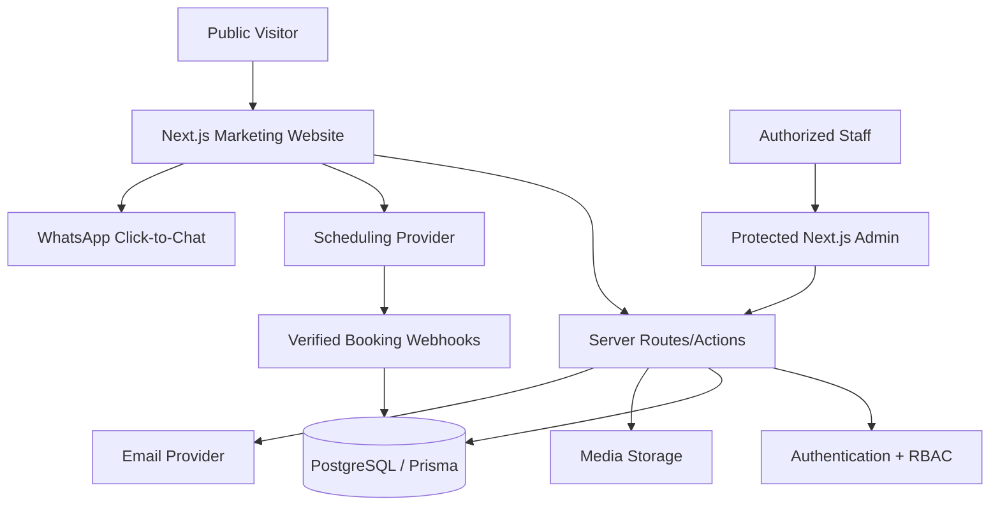

# Engineering Architecture, Database, Security, SEO and Performance

## Suggested technology architecture

**Scope:** one cohesive Next.js App Router codebase for marketing, dashboard and API boundaries. Adapt to an existing monorepo if provided rather than forcibly restructuring it.

| Concern | Recommendation |
|---|---|
| Framework | Next.js App Router + React + strict TypeScript; use supported stable compatible releases |
| Styling | Tailwind CSS v4, typed CSS variables and component tokens |
| UI building blocks | Accessible shadcn/ui/Radix-style primitives, bespoke brand compositions |
| Motion | GSAP/ScrollTrigger for orchestration, Motion for React for component transitions, CSS for simple hover; no conflicts |
| Backend | Next.js server actions/route handlers with documented service/repository boundary; add separate API only if needed |
| Data | PostgreSQL + Prisma migrations; suitable hosted managed database such as Supabase Postgres if owner configures it |
| Auth | Established secure auth library (Auth.js / better-auth) with invite-only admin accounts and server-side RBAC |
| Email | Resend or verified transactional email provider, domain verified before production |
| Booking | Hosted scheduler (e.g., Cal.com) with provider-confirmed availability and verified webhook sync; request-only fallback |
| Media | Vercel-compatible object storage / managed storage; CDN and secure upload flow |
| CMS | Admin-integrated CMS/editor for company data; consider external CMS only with explicit engineering rationale |
| Hosting | Vercel for marketing and application where appropriate; database/media/email are distinct services |
| Analytics | Privacy-aware website analytics and optional conversion events; no cookies without appropriate disclosures/consent |
| Logging | Structured server logging, error monitoring, audit trail for privileged operations |

Avoid unnecessary subscription commitments or paid feature assumptions. Document what's free vs billable and which external accounts the business owner must provide.

## Proposed architecture diagram



Important: the WhatsApp line is outbound contact **not** CRM chat synchronization until a separately authorized WhatsApp API integration exists.

## Route and file organization

```text
src/
  app/
    (site)/
      page.tsx
      about/page.tsx
      services/page.tsx
      services/[slug]/page.tsx
      work/page.tsx
      work/[slug]/page.tsx
      solutions/page.tsx
      solutions/[slug]/page.tsx
      technologies/page.tsx
      process/page.tsx
      insights/page.tsx
      insights/[slug]/page.tsx
      lab/page.tsx
      careers/page.tsx
      contact/page.tsx
      book-consultation/page.tsx
      start-project/page.tsx
    admin/...
    api/...
    privacy/page.tsx
    terms/page.tsx
    not-found.tsx
  components/
    brand/ layout/ marketing/ portfolio/ motion/ ui/ forms/ admin/
  features/
    inquiry/ leads/ clients/ bookings/ portfolio/ cms/ proposals/ projects/
  server/
    auth/ db/ repositories/ services/ integrations/
  lib/
    validation/ security/ metadata/ utilities/
  config/
  styles/
  types/
  tests/
prisma/
  schema.prisma
  migrations/
public/
  approved-assets/
docs/
```

Group route and feature code coherently; do not force code into one large page component. Use Server Components by default; mark interactive islands as client components only when needed. Keep sensitive queries server-only. Separate UI, business logic, provider adapters and data access.

## Database conceptual entities

Use real relational schema and migrations with indexes and foreign keys for:

- `User`, `Session`, `Invitation`, `Role` / `Permission` or enum mapping.
- `Client`, `Organization`, `ContactMethod`.
- `Lead`, `LeadActivity`, `LeadAssignment`, `FollowUp`.
- `Inquiry`, `InquiryAttachment`, `InquirySource`.
- `Booking`, `BookingType`, `BookingEvent`, `BookingProviderSync`.
- `Proposal`, `ProposalRevision`, `ProposalStatusEvent`.
- `InternalProject`, `ProjectMilestone`, `ProjectNote`.
- `PortfolioProject`, `PortfolioMedia`, `ProjectCategory`, `ProjectTechnology`, `ProjectRelation`.
- `Service`, `IndustrySolution`, `Technology`, `FAQ`, `Testimonial`, `Article`, `CareerOpening`.
- `Notification`, `EmailDispatch`, `AuditLog`, `SiteSetting`, `MediaAsset`.

Consolidate optional entities where reasonable; **do not build needless schema complexity merely to match names**. Add `createdAt`, `updatedAt`, publication flags and relevant ownership fields. Keep portfolio publication data independent of confidential internal client projects. Use soft-delete/archive when audit obligations or referencing records require it.

## Suggested data constraints

- Unique slug per published route content type.
- Verified/normalized email at edge, optional phone normalization.
- Project external URL must be valid HTTPS and only published after authorization.
- Booking uniqueness scoped to external provider + external booking ID (idempotency).
- Inquiry unique public reference and optional idempotency token.
- Proposal version uniqueness scoped to proposal ID.
- Enforce publication rights and roles at write boundary.
- Stored project screenshots must include alt text and publication approval flag.

## Authentication and authorization

- Invite-only users, no public `/admin/signup`.
- Use secure, HTTP-only session cookies with proper same-site, expiry, CSRF protections where applicable.
- MFA for privileged accounts where feasible; rate limit auth attempts; secure reset flow.
- Authenticate AND authorize all privileged server handlers and media accesses.
- Roles: SUPER_ADMIN, ADMIN, BUSINESS_DEVELOPMENT, CONTENT_MANAGER, PROJECT_MANAGER.
- Fine-grained object ownership/access checks; a content manager may edit public portfolio but should not automatically access all CRM data.
- Never rely on route middleware alone; server handlers must validate permissions.
- Audit role/invitation change, publication, sensitive record access and data export.

## Lead/booking/CRM integrity

- Forms: client + server Zod validation, anti-bot measures, rate limiting, upload scanning/allowlist/size limits as supported, helpful errors.
- Email: send after DB commit with retry/outbox pattern where useful; no false delivery status.
- Webhooks: verify signatures, idempotent processing, correct timezones, replay protection and event state transitions.
- Avoid double-booking; provider is source of truth if using embedded scheduling.
- Use database transactions for multi-record changes (e.g., inquiry + lead activity).
- Do not send credentials/private data in email unnecessarily.

## Contact and privacy

- Publish official areniX email, phone, WhatsApp and social links only after supplied/approved.
- Client phone numbers and inquiry contents are protected personal/business data.
- Collect explicit consent as appropriate for contact/inquiries, and separate marketing opt-ins.
- Set appropriate retention, privacy policy and data subject request mechanisms according to actual operations and jurisdiction.
- Never copy staff emails, client details, personal health information or financial records into sample project screenshots.

## SEO and content quality

- Unique metadata/title/description per page; canonical route, sitemap/robots, Open Graph/social previews.
- Article structured metadata, organization metadata with **verified** company details, breadcrumb schema where sensible; avoid fake aggregate ratings.
- Meaningful heading hierarchy and internal links; no duplicate thin `/services/[slug]` content.
- Portfolio captions and alt text explain actual screens, not keyword-stuffed generic descriptions.
- CMS draft preview is private; not indexed.
- Not-found, redirects, broken outbound link handling.

## Web performance requirements

- Core Web Vitals goals: LCP ≤ 2.5s, INP ≤ 200ms, CLS ≤ 0.1 on representative production conditions; target Lighthouse 90+ performance and 95+ accessibility/SEO where achievable, then **report measured results**, not invented passes.
- Optimized Next/Image with real sizing, lazy-loading, priority only on relevant above-fold media.
- Format large images responsibly; responsive variants; AVIF/WebP as possible.
- Lazy load video/3D; suspend expensive animations when not visible; poster frames and reduced-motion fallback.
- Respect browser cache; avoid a giant all-pages JS bundle; load dashboard modules only in admin.
- Prevent unnecessary hydration, scroll-jank and GPU overload on low-end phones.

## Accessibility minimum

- Semantic nav, main, header, footer and heading order.
- Keyboard navigation, clear focus ring, ESC for modal/mobile nav/lightbox, accessible form errors, sensible ARIA where needed.
- Touch target sizes and accessible controls, including portfolio screenshot galleries.
- No essential content revealed only on hover or only after a scroll animation.
- No invisible content if JS fails; reduced-motion fallback; sufficient contrast.
- Respect screen reader announcements for validation/filter results, avoid focus loss on client navigation.

## Testing

- Unit: validators, URL/link rules, role/permission policies, status transitions, screenshot availability.
- Integration: inquire->DB->notification; appointment webhook sync; proposal state changes; CMS publish/unpublish and cache invalidation.
- E2E Playwright: marketing nav, real project case study, live-site link, WhatsApp URL, contact/quote flows, booking real or fallback, auth roles, admin CRUD.
- Visual regression: 320, 375, 430, 768, 1024, 1440, 1920 widths, dark/light components where used.
- Lighthouse & a11y scan on representative pages; manual keyboard/touch test.
- Typecheck, lint, production build, migrations and basic security validation before deployment.

## Required environment example (names only)

```dotenv
DATABASE_URL=
DIRECT_URL=
AUTH_SECRET=
NEXT_PUBLIC_SITE_URL=
ADMIN_NOTIFICATION_EMAIL=
EMAIL_FROM=
RESEND_API_KEY=
MEDIA_STORAGE_CONFIG=
NEXT_PUBLIC_WHATSAPP_E164_DIGITS=
SCHEDULER_PROVIDER=
SCHEDULER_PUBLIC_EVENT_LINK=
SCHEDULER_WEBHOOK_SECRET=
ANALYTICS_CONFIG=
```

Treat examples as a starting point, not a demand to expose secrets to frontend. Any field suffixed `NEXT_PUBLIC_` must be safely public; phone and public site URLs only. Add provider-specific configuration per actual implementation and version.
