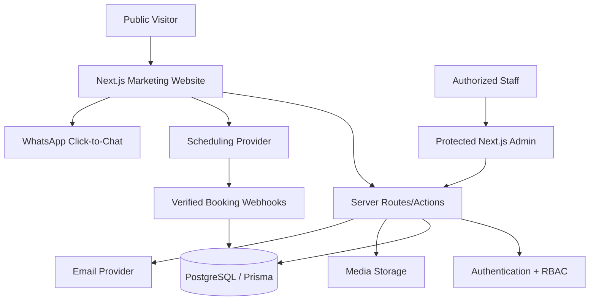

# ARENIX, ALL-IN-ONE PRODUCTION BUILD PROMPT

**Copy/paste this file into a coding agent when it cannot read the companion Markdown specifications.** It combines the entire build plan and acceptance rules below. Follow section order, record unresolved inputs, and implement in verified phases. Never invent project facts, asset permissions or functioning external integrations.

---
<!-- BEGIN 00_MASTER_BUILD_PROMPT.md -->

# MASTER BUILD PROMPT, areniX Corporate Website & Business Operating Platform

## Role and objective

You are a coordinated senior team: creative director, brand designer, interactive UX engineer, Next.js/TypeScript full-stack architect, motion specialist, QA lead, accessibility specialist and technical SEO engineer.

Build a complete, original, production-ready digital headquarters for **areniX Technologies Limited**, publicly branded **areniX**. The deliverable comprises:

1. A **cinematic, design-led public marketing website**, every route and significant section has considered typography, layout, motion, and meaningful interactions.
2. A **real interactive portfolio** with authorized screenshots of actual project pages and working internal case-study links plus external `Visit Website` / `Open App` links only where public deployments exist.
3. Multi-channel **client acquisition**: service inquiries, WhatsApp click-to-chat, consultation scheduling, quote requests, consent-aware confirmation emails, and actionable calls to action.
4. A protected **areniX business dashboard**: leads, CRM, inquiries, bookings, project/quote pipeline, notifications, content management, portfolio media and settings.
5. A reliable engineering foundation with mobile responsiveness from **320px**, security, performance, SEO, accessibility, monitoring, and maintainable documentation.

This is not a static design exercise, copied Webflow template, generic dashboard starter, or portfolio-only one-pager. Produce working, connected functionality.

## Required reference websites, MUST analyze them before implementation

- https://altreex.webflow.io/
- https://onart-studio.webflow.io/project/voyage (and https://onart-studio.webflow.io/)
- https://visione.webflow.io/
- https://monoform-template.webflow.io/
- https://nexifye.webflow.io/

Inspect public homepage, navigation, sections, linked service/about/work/case-study/content/contact pages wherever available. Review actual responsive behavior, hover, menu, scrolling and transitions **where observable**. Write a concise `docs/design-reference-audit.md` with what is observed and what remains unverified. The provided five URLs are mandatory inspirations for the *marketing experience across all pages*; translate their **design principles**, not their logos, code, layout clones, text, photos, or proprietary assets. If a reference is inaccessible, explicitly record the limitation and continue with the supplied design requirements.

At minimum synthesize:
- **Altreex:** editorial/creative layouts, large project grids, expressive service composition.
- **Onart / Voyage:** oversized case-study heading, service/industry/year metadata, full-width imagery, project goals/outcomes, gallery and related-project routing.
- **Visione:** cinematic media storytelling, bold typography and immersive section pacing.
- **Monoform:** refined minimalism, strict typographic hierarchy, editorial whitespace, selected-work structure.
- **Nexifye:** technology/consulting credibility, dashboard/product imagery, service clarity, conversion-driven presentation.

Create a **unique areniX look** using a near-black/graphite + selective off-white editorial theme, restrained brand accent sourced from actual logo assets when supplied, striking type, intelligent motion, polished screens, and exceptional readability. Do not fabricate a brand guide if none was provided; record temporary design-token assumptions.

## Non-negotiable pages and interactions

Build the route inventory specified in `02_PUBLIC_WEBSITE_PAGES.md`:

`/`, `/about`, `/services`, `/services/[slug]`, `/work`, `/work/[slug]`, `/solutions`, `/solutions/[slug]`, `/technologies`, `/process`, `/insights`, `/insights/[slug]`, `/lab`, `/careers`, `/contact`, `/book-consultation`, `/start-project`, `/privacy`, `/terms`, and genuine not-found/error/loading pages. Keep routes navigable and genuinely populated. Avoid dead placeholder pages.

Every public page needs page-specific section composition and motion. Reuse the *system*, not one generic section template everywhere. Ensure mobile-friendly equivalents and reduced-motion fallbacks.

## Portfolio, make actual work the centerpiece

Initial project roster:

- **Passion Nutrition Clinic**, healthcare/nutrition website; known public URL: https://passion-nutrition-clinic.vercel.app/
- **Paylio Staff Management**, staff/workforce system; publish only approved, non-sensitive screenshots and facts.
- **Paylio Dashboard**, operations/admin dashboard; connect to the same case study where the modules are one delivery.
- **netHuk**, *In Development*; do not assume industry, features, URL, release date or production readiness.
- **CleNest**, laundry and cleaning service web platform; known public URL: https://www.clenest.site
- **ArenoX LMS**, education/learning platform; only confirmed capabilities.
- **Annotrix**, assessment and evaluation platform; only confirmed capabilities.
- **AreniX Branch Manager**, retail/inventory/sales/operations management solution; state delivery status truthfully.

Use real project images: chosen live website pages, dashboards, mobile pages and screenshot galleries. Automate screenshots of genuinely public accessible pages using Playwright where permitted; sanitize customer/user/private data. Each card must support **View Case Study** (internal `/work/[slug]`) and **Visit Website / Open App** (external URL, new tab) only where valid/public; no invented URLs. Build detailed, distinctive case studies with challenge, implementation, gallery, engineering contributions, verified outcomes, related projects. CMS-configurable content and media.

## Conversion & customer contact

- Configurable company WhatsApp click-to-chat CTA on site navigation, service pages, portfolio CTA and mobile sticky action where appropriate. Use real official number supplied in configuration, never CleNest's or an invented number. Prefill service/project context. Plain click-to-chat **does not** synchronize messages to CRM; do not promise this without official approved integration.
- `/book-consultation`: genuine appointment availability, selected consultation type, timezone-aware date/time, booking confirmation, reschedule/cancel. Prefer configured scheduling provider integration (e.g., Cal.com hosted/embedded + verified webhook) for first release. If no credentials/availability integration exists, show an honest **request a consultation** form, not fake slots or a fake confirmed appointment.
- `/start-project`: functioning detailed service/quote request. Validate, persist to DB, notify authorized staff, return a real reference ID/confirmation after success. Protect against spam and unsafe files.
- `/contact`: functioning general inquiry, clearly visible verified email and channels when configured.

## Private business dashboard

Create authenticated, server-authorized `/admin` with:
- KPI overview (real data, useful filters)
- CRM contacts/organizations, leads and follow-ups
- Inquiry queue and qualification workflow
- Bookings/calendar (sync status and provider identifiers)
- Proposals/quotes with status and versioning, controlled sending
- Internal client project register and milestones
- CMS: portfolio, screenshots, home features, services, technologies, case studies, posts, testimonials, careers, FAQs, SEO
- Notifications and activity/audit log
- Team invitations and roles
- Brand and integration settings

Use a restrained modern SaaS interface, not scroll-jacking or huge headline animations inside operational tables. Roles: `SUPER_ADMIN`, `ADMIN`, `BUSINESS_DEVELOPMENT`, `CONTENT_MANAGER`, `PROJECT_MANAGER`; enforce server-side least privilege. Do not allow public admin signup. Do not expose internal client materials to public pages.

A **client portal** is phase-two/three architecture unless deliberately included in the agreed build scope; never give customers admin accounts. Support later `/portal` for their own projects, milestones, files and approved communications.

## Technology baseline

Prefer TypeScript + Next.js App Router + React + Tailwind CSS v4 + accessible component primitives + GSAP/ScrollTrigger (complex scroll storytelling) + Motion for React (UI/component transitions) + CSS for simple interactions; optionally Lenis or Three.js *only* where justified. Use PostgreSQL + Prisma, secure auth (Auth.js or better-auth evaluated against requirements), server-side Zod validation, email through Resend, object storage for media, and Vercel hosting where viable. Scheduling provider and CMS decisions must be documented; because the dashboard requires content management, prefer a unified CMS module unless the team substantiates an external solution. No uncontrolled overlapping animation systems.

Configure integration secrets in environment variables, and provide functional local mocks only for development/testing clearly labeled *demo*; never masquerade them as live production integrations.

## Implementation workflow

1. Audit existing repository and source materials; do not replace existing work blindly.
2. Review five references. Produce reference audit, page inventory, design/motion specs and media inventory.
3. Establish brand tokens, navigation, shared layout, reusable motion components, site data schemas, auth and DB.
4. Build and verify the entire public marketing UI with accurate project content and responsive motion.
5. Implement functioning contact, quote, WhatsApp links, booking provider or clearly labeled booking-request fallback.
6. Implement dashboard, RBAC, CRM pipeline, CMS/media, booking sync, proposal workflow and notifications.
7. Test every route, click target, form, protected endpoint and responsive breakpoint.
8. Perform real build, typecheck, lint, accessibility and performance checks. Fix critical issues before declaring completion.

**Do not pretend to have built anything until the code, navigation and backends work.** If APIs/assets/credentials are missing, use maintainable interfaces, safe placeholders and explicit dependency flags; finish what can be built and clearly enumerate blocks. Never invent project results, staff, awards, years, numbers, ratings or testimonials.

## Required deliverables

- Application code and documented architecture
- Working public site + private dashboard
- Typed DB schema/migrations
- Content fixture with accurately labeled project status
- Real screenshot/media support and at least approved/available starter media
- `.env.example` without secrets
- Operational README, deployment instructions and admin guide
- Full route/feature verification checklist
- `docs/design-reference-audit.md`
- QA report with tested routes/breakpoints, measured scores or explicit unmeasured states

Read all accompanying `.md` documents and treat their acceptance criteria as part of this prompt. If running as a single pasted prompt, use `99_ALL_IN_ONE_BUILD_PROMPT.md` instead of this file alone.

<!-- END 00_MASTER_BUILD_PROMPT.md -->

---

<!-- BEGIN 01_BRAND_DESIGN_AND_MOTION.md -->

# Design System, Five-Reference Synthesis & Motion Direction

## The single design promise

**The marketing UI on every public page combines all five user-supplied design references.** The finished areniX experience must communicate premium creative execution **and** trustworthy software engineering. The dashboard inherits brand tokens but optimizes for operations, not spectacle.

## Research matrix

| Source | Borrow the principle | How areniX interprets it | Don't copy |
|---|---|---|---|
| https://altreex.webflow.io/ | Editorial mixed-grid portfolio, expressive service sections, spacious composition | Unexpected but controlled project sizing, numbered capability rows, alternating layout | Site-specific graphics, artwork, full section replicas |
| https://onart-studio.webflow.io/project/voyage | Project label/title, metadata matrix, broad imagery, goals/outcomes, related projects, strong closing footer | Real screenshot-led product case studies and technical solution storytelling | Voyage media, wording, photography, logo |
| https://visione.webflow.io/ | Cinematic rhythm, immersive media, large editorial typography | Showreel from authentic app footage, dramatic reveal on major transitions | Branded showreel/copyrighted media |
| https://monoform-template.webflow.io/ | Restrained editorial typography, white space, refined project indexing | Consistent grid, disciplined visual rhythm, legible minimal presentation | Theme clone, page-by-page layout reproduction |
| https://nexifye.webflow.io/ | Technology/product presentation, dashboard mockups, credible value proposition, conversion blocks | Floating *real* Paylio/ArenoX/CleNest dashboard screen compositions, clear services + CTAs | Fake testimonials, fake product screenshots |

When possible, explore their nav, project work pages, mobile layouts, hover and scroll behavior and document **observed** facts separately from **designed-for-areniX** proposals. If something can't be observed, implement sensible originals rather than asserting it exists on the reference.

## Brand naming and tone

- Full legal name: **areniX Technologies Limited**.
- Short/public brand: **areniX**. Preserve lowercase `areni` + uppercase `X` when typography allows.
- Proposed homepage headline: **We build technology that moves ideas forward.** This is provisional copy, not a registered company motto.
- Supporting copy: “areniX designs and engineers digital products that help businesses work smarter, serve customers better, and scale with confidence.”
- Clear writing: technologically competent, human, specific and evidence-based. Avoid grandiose claims (“Africa's #1”, “100+ clients”, “award-winning”) without verification.
- Tone: credible business partner, not a single-developer resume site; still describe individual contribution precisely when projects were built personally.

## Art direction and tokens

### Palette (starter tokens; override with official logo palette)
- `--ink: #090B10` near-black
- `--surface-deep: #11151C`
- `--surface-raised: #1A202B`
- `--paper: #F5F4F0` warm neutral
- `--paper-muted: #EAEAE5`
- `--text-on-dark: #F5F5F3`
- `--text-on-light: #141821`
- `--muted: #A6AFBB`
- `--accent: brand-derived` (temporary placeholder, never choose randomly)

Use dark/light alternation with meaningful contrast; restrained luminous gradient on important surfaces, not everywhere. Glass UI effects are selective and always readable. Keep gradient/logo effects tasteful and performant.

### Typography
- Expressive grotesk variable display face; legible sans body font.
- Fluid `clamp()` scale for headings; on mobile never crop long names.
- Some uppercase micro-labels and numeric section indices; body copy optimized for actual reading.
- Rhythm: large display headings, short lead text, good empty space, carefully aligned media.

### Spatial system
- Container max width ~1360 to 1520px with fluid gutters, not fixed-width.
- 12-column large-screen grid, flexible tablet 6-column, mobile 4-column where practical.
- Narrow readable text lines (~55 to 75 characters for long-form body).
- Intentional responsive image crops, full-width visual moments, asymmetric sections where helpful.
- Clear focus, error, success, disabled states.

## Required reusable motion vocabulary

| Motion pattern | Best use | Implementation notes |
|---|---|---|
| Masked line reveal | Home/About/Services/Work page headings | GSAP or Motion with safe hydrated text fallback |
| Full-width media scale/reveal | Showreel, project hero, case-study gallery | ScrollTrigger once, avoid heavy layout paints |
| Editorial stagger | Process steps, tech badges, value propositions | Modest gap, no cascade fatigue |
| Directional hover reveal | Project cards, service rows, links | Works with mouse, focus; mobile uses explicit UI |
| Soft parallax | Hero layered screenshots, select galleries | Transform only, disable/reduce mobile |
| Sticky story panel | Process, selected case-study features | Avoid nested scroll trapping, expose accessible text |
| Horizontal selected-work chapter | One immersive desktop gallery only | Vertical fallback on touch/small screens |
| Page transitions | Major marketing route changes | Never delay focus/navigation or browser history |
| Magnetic CTA | Precise-pointer desktop, select primary actions | Simple non-magnetic fallback touch/keyboard |
| Animated nav overlay | Mobile navigation | Focus trap, Escape, overlay dismissal |
| Grid morph/reorder | Work filters | Do not move focus unexpectedly |
| Animated project screenshots | Portfolio hover, case study viewer | Real/approved media, accessible next/previous controls |
| Dashboard micro-motion | Drawer, toast, filter, tabs, dialogs | 100 to 250ms, functional, no scroll hijacking |

## Motion architecture

- GSAP + ScrollTrigger: pinned sections, scroll-linked image scale, coordinated complex timelines.
- Motion for React: component mount/unmount, modal/drawer, routing integration, selection transitions.
- Native CSS transitions: color/opacity/transform hover and focus.
- Optional Lenis: test whether smooth scrolling adds value; respect anchor navigation and reduced motion; do not sabotage native scrolling.
- Optional R3F/Three.js: only one compelling and useful visual, lazy-load, pause offscreen, no battery-draining “random floating objects.”
- Centralize motion duration/ease tokens, cleanup and breakpoints.

### Motion timing guidelines
- Press/hover response: 120 to 250 ms
- Card interactions: 250 to 500 ms
- Reveals: 500 to 850 ms
- Page transitions: 450 to 900 ms maximum, subject to user control
- No artificially prolonged preloader; allow skip, avoid repeat on every navigation.

### Cross-device rules
- `prefers-reduced-motion: reduce`: static or minimally faded content; content never hidden behind unrun animations.
- Touch: all navigation, gallery and detail controls remain visible.
- Keyboard: focus, tab order, overlays, Escape handling and explicit labels.
- Avoid opacity 0 content relying on JavaScript before hydration.
- Use `gsap.context()` / cleanup of triggers and proper route transition lifecycle.
- No repeated scroll/pointer event handler leaks.
- Do not set `will-change` on every element permanently.
- Non-decorative media has captions/alt text; heavy video has poster and pause/control or appropriate autoplay safeguards.

## Section-specific design examples

1. **Home hero**: split title, actual app interface collage, one brand-accent light flare, editorial CTAs, controlled intro reveal.
2. **Selected work**: large alternating project media, preview details, scroll sequence or grid with meaningful filters, direct case-study and live-site actions.
3. **Services**: Altreex/Monoform-inspired indexed rows; large hover media; details that expand accessibly.
4. **Project case study**: Onart-inspired hero/metadata/hero image; engineering story; full-size screenshot chapters; next-project takeover.
5. **Solutions**: Nexifye-inspired browser/dashboard frames and corresponding business outcomes.
6. **Insights**: precise typographic editorial grid, responsive article covers and smooth filtering.
7. **Footer**: oversized areniX wordmark, dark gradient field, clear CTA, numbered navigation and real contacts.
8. **Dashboard**: clean modern SaaS layout, compact text sizes, info hierarchy, functional tables; use marketing visuals only sparingly.

## Page-by-page design audit checklist

For *every* public page and major section, record: `section ID | composition inspiration | original areniX treatment | entrance | scroll response | hover/focus | mobile | reduced-motion | CTA destination | asset status`. This audit must show that animation and design are intentionally present across all public routes, **not only on the homepage**.

## Non-goals

- No copyrighted reference asset copying.
- No gratuitous animation merely to satisfy a numeric animation count.
- No “AI-generated look” with generic giant gradient blobs and repetitive cards.
- No fake testimonials, logos, client figures, awards or case-study outcomes.
- No WordPress/Webflow template recreation unless user expressly changes the stack.

<!-- END 01_BRAND_DESIGN_AND_MOTION.md -->

---

<!-- BEGIN 02_PUBLIC_WEBSITE_PAGES.md -->

# Public Marketing Website, Complete Route & Section Inventory

**Global:** Shared navigation, animated but accessible route entrance, breadcrumb where relevant, consistent CTA strategy, intentional branded footer, business WhatsApp action, keyboard usability, accurate SEO metadata. Every page must feel distinct within the same brand system. Internal `/admin` is specified separately.

## 01. Home, `/`

**Purpose:** Identity + immediate credibility + portfolio-first conversion.

| Order | Section and content | Visual/animation behavior | CTA |
|---|---|---|---|
| 1 | Hero: areniX branding, strong statement, differentiated offer, 2 CTAs | Branded intro (skippable), split-line reveal, real app UI layered composition, subtle scroll depth | Explore Work / Start Project |
| 2 | Authentic project showreel | Cinematic media mask and restrained scroll scale, pause/controls; poster if no real footage | View Work |
| 3 | Company preview | Editorial text block, number label, offset real studio/product image, image parallax | About areniX |
| 4 | Services preview | Indexed giant rows, media-change on hover/focus; tap expand on mobile | All Services |
| 5 | Selected portfolio (6 to 8 configurable projects) | Varied size real screenshots, hover live previews, tasteful active image transitions, case-study overlay | View Case Study + Visit Website where available |
| 6 | Real dashboard showcase | 2 to 4 permission-approved software screens, floating layered frames, scroll narrative | Explore Solutions |
| 7 | Industries | Interactive sector switcher, changing supporting media; clarify use cases vs completed engagements | Explore Solutions |
| 8 | Technology stack | Categorized technical grid with responsive reveal | Technologies |
| 9 | Working process | Sticky vertical step timeline or mobile accordion with visual changes | Our Process |
| 10 | Trust/credibility | Real client approvals, testimonials or omit; no invented metrics | Start Project |
| 11 | Insights preview | Latest *published* articles; empty state until they exist | Insights |
| 12 | Large contact CTA | Dramatic color/typography shift and big button | Book Consultation / Start Project |

## 02. About, `/about`

Sections: editorial hero; who we are; verified company story; vision/mission; values; approach to engineering & design; team or leadership if authorized; authentic milestones; where we work (publish only approved location/contact); final CTA. Motion: words/lines reveals, scroll storytelling with sticky image, value-card activation, timeline movement, contrasting section transitions. Keep text searchable and accessible.

## 03. Services, `/services`

Sections: major editorial hero; service positioning; 8 primary service categories; featured delivery examples; technical approach; delivery stages; engagement models without invented prices; relevant portfolio; FAQs; consultation CTA.

Proposed service categories:
1. Custom Software & Web Applications
2. Corporate Websites & Web Development
3. SaaS Product Engineering
4. Enterprise & Operations Systems
5. Mobile Application Development
6. UI/UX & Product Design
7. API Integration & Automation
8. Cloud Deployment, Maintenance & Technical Consulting

Only actively market confirmed capabilities; admin can unpublish offerings not yet available.

Interactions: typography reveal, indexed hover rows, service media swap, accordion details, anchor/sticky navigation, CTA scroll; responsive explicit controls.

### Service detail, `/services/[slug]`

Sections: service-specific hero with custom imagery; problems addressed; solutions/deliverables; sample workflow; technical approach; related **real** case studies; FAQ; booking and project CTA. Use distinct layouts/hero art for meaningful service differences rather than template title swaps. Motion: masked screenshot, category pills, column stagger, optional sticky value statement, related project transition.

## 04. Portfolio, `/work`

Sections: portfolio hero; featured case study; searchable/filterable work grid; status/industry/service filters; capability highlights; large lead-generation CTA. Each project image/title links to internal `/work/[slug]`. Render clearly labeled **View Case Study** and **Visit Website / Open App** actions; external link only if public and configured. Screenshots should be authentic, user-authorized and cropped intentionally.

Motion: dynamic layout reflow without scroll jumps, image switching on hover, keyboard focus visual, correct mobile touch controls, branded detail-page entrance.

### Individual case study, `/work/[slug]`

Use **Onart/Voyage** as a strong composition reference:
1. Back to work / breadcrumb
2. Large project name and introductory statement
3. Metadata: project type, industry, year *if verified*, contribution, status
4. Main authentic project screenshot / hero video
5. Business context and brief
6. Challenge and objectives
7. Approach, discovery and design
8. Screenshots: real key pages and workflow states
9. Engineering/architecture breakdown, only if disclosure permitted
10. Features; demonstrate value with UI, not marketing filler
11. Devices/responsive previews
12. Outcomes, factual metrics only; otherwise qualitative capabilities
13. Project status, demo/live/repo buttons where appropriate
14. Related work
15. Large next-project transition + final CTA

Motion: media reveal, selective gallery parallax, metadata stagger, scroll-led feature panels, focusable lightbox, real UI tab/slide interactions, next-case transition. No project may have a dead page or fake outcome.

## 05. Solutions, `/solutions` and `/solutions/[slug]`

Sections: hero; grouped sectors (education, healthcare, retail, workforce, hospitality, startup); problems/business needs; relevant real solutions vs proposed capabilities; dashboard-supported product imagery; integrations; delivery method; case studies; CTA. Detail pages: sector-specific use cases, workflow, architecture high level, related proof and conversion. Motion: interactive category selector, image swap, scroll-linked product mockups, accessible tabs and content reveals.

## 06. Technologies, `/technologies`

Sections: engineering philosophy; frontend (React/Next.js/TypeScript), backend (Node/NestJS/Express/Python where verified), databases (PostgreSQL/Prisma/MongoDB), mobile (React Native), cloud/deployment, systems architecture and integrations; stack-to-project mapping; CTA. Interactive grouped tech grid and visual architectural diagrams; no false certificate/vendor partnership logos.

## 07. Process, `/process`

Sections: discover; scope; product/UX design; architecture; build; QA/security; launch; maintenance/support; expectation-setting; CTA. Editorial process timeline with sticky visual, scene transitions, progress indicator and practical deliverables. Mobile version uses stack/accordion, not broken pinning.

## 08. Insights, `/insights` and `/insights/[slug]`

Listing: blog hero, featured article, category filters, text search, article grid, pagination, newsletter only if consent-compliant and functional. Article: hero, real author/date, reading time, optional TOC, cover, structured rich text, code blocks and syntax highlighting, accessible media, reading progress, related articles, service CTA. Motion: understated article image reveal, card hover and controlled transitions. Empty state if unpublished.

## 09. Innovation Lab, `/lab`

Explain product experiments and work in progress honestly. Sections: experimental hero; in-development work incl. netHuk; prototypes; technical notes; available demos; updates. Must not represent concepts as shipped software. Use distinctive cards, layered visuals and thoughtful motion.

## 10. Careers, `/careers`

Sections: editorial hero; culture/principles; work approach; verified roles from CMS; application or contact workflow; FAQ. Show professional **no current openings** state when empty. Do not invent hiring or collect unnecessary personal information. Motion: balanced reveals, tasteful role hover, not distracting effects.

## 11. Contact, `/contact`

Sections: large editorial invitation; short contact options; official WhatsApp link; email (only after configured); general inquiry form; location if appropriate; social links if verified; FAQ; closing CTA. Motion: heading reveal, animated fields and true submission state. Include anti-spam, validated persistence, acknowledgment email, and helpful error reporting.

## 12. Consultation booking, `/book-consultation`

Sections: consultation choice, expectation and optional duration, working embedded scheduler with valid availability or clearly labeled callback-request fallback; timezone display, contact details, confirmation/reschedule/cancel states. No fake slot inventory, no placeholder confirmation. Maintain branded framing, accessible date/time selection and service context in link.

## 13. Start a project, `/start-project`

Sections: short explainer, inquiry wizard or well-designed single form; service/solution category, client details, project requirements, budget optional, timeline optional, attachments optional, preferred contact method, consent. Validate server-side; on success show unique saved reference and action for booking consultation. If multipart wizard, preserve progress and avoid unnecessary mandatory fields.

## 14. Policies and system pages

`/privacy`, `/terms`, `not-found`, loading and error states. Use readable editorial layout and consistent brand. Add legally reviewable placeholder text marked **Draft, review before launch**, not fake polished legal guarantees. A business owner/legal professional should review policies against real data flows and applicable law before publication.

## Navigation and footer

Desktop links: Home, About, Services, Work, Solutions, Technologies or Process (possibly dropdown), Insights, Contact; persistent CTA `Start a Project` and optional `Book a Call`. Mobile must have full accessible menu and relevant WhatsApp CTA. Footer: large areniX mark, contact CTA, real verified socials, all core links, legal, business name and current year.

## Business conversion principle

Services and case studies should offer contextual CTAs: **Book a consultation**, **Request a quote**, **Chat on WhatsApp**. Don't make users go to a generic form with no selected service or project context.

<!-- END 02_PUBLIC_WEBSITE_PAGES.md -->

---

<!-- BEGIN 03_PORTFOLIO_CASE_STUDIES.md -->

# Portfolio System, Real Screenshot Galleries, Case Studies & Live Links

## User-critical requirement

**Every project card must feature an image of an actual page or authentic UI of that project.** Users can:

- Click the project picture or title → **internal** `/work/[slug]` case-study page.
- Click **View Case Study** → same internal case-study route.
- Click **Visit Website / Open App** → **real public deployed URL** in a new tab *if known, reachable and approved*.
- View more genuine screenshots inside case studies: homepage, services, workflow, dashboard, mobile, other functional pages (as relevant).

Display **In Development**, **Private System**, **Concept**, **Live**, or **Completed** clearly. A private system may have screenshots only if sanitized/authorized; it must not offer a public live URL or unauthorized demo credentials. Case studies remain viewable without live URLs.

## Initial records, no fabricated URLs

| Project | Focus | Known public URL | Media recommendation | Status/data rule |
|---|---|---|---|---|
| Passion Nutrition Clinic | Healthcare and nutrition website | https://passion-nutrition-clinic.vercel.app/ | Actual homepage, services, contact/booking section, mobile viewport | Verify current live state and what areniX built |
| Paylio Staff Management | Staff and workforce operations | **Not supplied** | Sanitized employee table/management/approval workflow | Private/client system; permission first |
| Paylio Dashboard | Admin and operations reporting | **Not supplied** | Permission-approved sanitized dashboard charts/pages | Link to staff system case study if same platform |
| netHuk | Product under development | **Not supplied** | Actual development screenshots or branded **preview pending** state | **In Development**; do not guess features |
| CleNest | Cleaning/laundry ordering and service operations | https://www.clenest.site | Homepage, pricing/services, customer order flow, dashboard only if safe | Verify accessible public and approved private UI |
| ArenoX LMS | LMS/education product | **Not supplied** | Landing, courses, student/instructor/admin roles where safe | Verify status and exact deployed URL |
| Annotrix | Assessment platform | **Not supplied** | Exam interface, admin test setup, analytics if safe | Verify deployed status and details |
| AreniX Branch Manager | Retail management solution | **Not supplied** | POS/inventory/dashboard/sales interface | Do not imply client deployment unless verified |

Other verified projects can be added through admin CMS. Avoid counting a single platform twice as separate clients merely because it has two modules.

## Screenshot pipeline

### For publicly accessible projects

1. Retrieve the actual live URL from approved `project.liveUrl`.
2. Inspect pages and list the URLs/sections selected as evidence.
3. Capture screenshots using an allowed Playwright browser run. Suggested sizes: 1440×900 desktop, 390×844 mobile; optional full-page captures for gallery sections.
4. Do not capture login screens with passwords/tokens, private user information, cookies, or proprietary information without permission.
5. Crop/place within original, reusable browser/device mockups; don't falsify interface states.
6. Optimize images to WebP/AVIF where supported. Preserve accessible alt text and a sensible aspect ratio.
7. Store in object storage or static approved assets and reference through typed media records.
8. Run visual QA to ensure the thumbnail actually corresponds to that project.

### For private or unfinished projects

1. Request approval for public case study/screenshots from authorized owner.
2. Use manually provided, permission-approved sanitized UI captures or purpose-built illustrative mockups **clearly labeled** as concept/previews.
3. Never publish real staff names, salaries, email addresses, phone numbers, bank details, admin tokens, user lists, client IPs or private business records.
4. If no usable screenshot exists, render an editorial designed placeholder **“Preview being prepared”** or genuine abstract product illustration identified as non-product media; do not pretend it is a real app screenshot.

## Portfolio card anatomy

- Primary image of actual homepage/application page (`image.alt` descriptive)
- Project title and short description
- Industry / service category
- Technical stack labels only if verified
- Current project status
- **View Case Study** internal link
- **Visit Website** external link if `liveUrl && isPublic && approved`; `target="_blank" rel="noopener noreferrer"`
- Optional `View GitHub` only when a repository is legitimately public/approved
- Optional preview switcher with 2 to 3 screenshots using arrows/dots on touch; hover crossfade on precise-pointer devices
- Loading skeleton, errors and missing-media safe state

Cards support keyboard focus and clear separate click targets; don't nest links inside links or cause ambiguous click areas.

## Case study content schema

```ts
type ProjectStatus = 'LIVE' | 'COMPLETED' | 'IN_DEVELOPMENT' | 'CONCEPT' | 'PRIVATE';

type ProjectMedia = {
  id: string;
  src: string;
  alt: string;
  caption?: string;
  kind: 'screenshot' | 'video' | 'illustration' | 'device-mockup';
  pageLabel?: string;
  isAuthenticScreenshot: boolean;
  approvedForPublication: boolean;
  width?: number;
  height?: number;
  sortOrder: number;
};

type PortfolioProject = {
  slug: string;
  title: string;
  teaser: string;
  description: string;
  clientOrOwner?: string;
  publishedRole?: string;
  industry?: string;
  services: string[];
  technologies: string[];
  status: ProjectStatus;
  year?: number; // Only when verified
  coverMedia?: ProjectMedia;
  gallery: ProjectMedia[];
  challenge?: string;
  goals?: string[];
  approach?: string;
  features: string[];
  outcomes?: string[]; // Genuine verifiable statements only
  liveUrl?: string;
  repoUrl?: string;
  isLiveUrlPublic: boolean;
  approvedForPublication: boolean;
  featured: boolean;
  sortOrder: number;
  publishedAt?: string;
};
```

## Case study layout & interaction

**Use the Onart Voyage page as a key structural influence**, then add software-specific proof:

1. Animated editorial project header (`PROJECT / title`, intro, key metadata).
2. Large featured **real screenshot** framed as browser or product preview.
3. Project brief, context, contributions and permission-safe details.
4. Challenge → engineering response → features.
5. Full-width high-resolution screenshot sequences with clear captions (`Homepage`, `Dashboard`, `Settings`, etc.).
6. Optional **interactive image gallery/lightbox** and keyboard/touch controls, zoom limits, next/previous.
7. Device comparisons (mobile/desktop) only when captured from actual responsive UI.
8. Architecture/technology stack visual if approved.
9. Real outcome or honest development status; no invented revenue or performance lifts.
10. Actual live project CTA when valid; otherwise `Private Client System` or `In Development` status + project inquiry CTA.
11. Related projects (real CMS relation), next-project title/reveal, back-to-work.

### Advanced (optional) interactive preview

A screenshot story may switch through `Homepage → Product Page → Dashboard` as the viewer scrolls, but do not make the user watch an inaccessible slideshow to find important content. Provide a manual gallery and reduced-motion/static counterpart. Never embed a private admin panel into the marketing site.

## CMS requirements

Admin must upload/update/reorder project screenshots, set cover image, media type, alt/caption, status, preview order, published URL, repository URL, industry/tags, featured order, draft/publish, approvals and related projects. Validate URL scheme (`https://`), image MIME/type/size/dimensions, access control and safe storage. Publishing requires explicit content approval state for confidential client work.

## Exact link behavior

- Known external: Passion Nutrition Clinic → `https://passion-nutrition-clinic.vercel.app/`.
- Known external: CleNest → `https://www.clenest.site`.
- All others: `liveUrl: null` until owner supplies and approves URL.
- Internal `View Case Study` works for every **published** project record.
- No disabled “Visit Live” button styled as if it works; omit it and show reason/status instead.
- Revalidate external URLs before publishing; a temporarily down site must not generate a fake claim that it is live.

## Acceptance tests

- Every featured project has the correct brand/title/media pairing.
- `View Case Study` navigates correctly, including keyboard and browser back.
- `Visit Website` uses the exact provided/verified destination and opens safely.
- Private/not-yet-live entries never show a forged public link.
- Screenshots render responsively, have meaningful alt text, and never leak private data.
- Galleries work with arrow keys/Escape/swipe where supported.
- Project filters/search reliably update visible results and accessible status announcements.

<!-- END 03_PORTFOLIO_CASE_STUDIES.md -->

---

<!-- BEGIN 04_BOOKINGS_CRM_AND_ADMIN.md -->

# Booking, WhatsApp, Client CRM, Admin Dashboard & Client Journey

## Core system idea

Visitors discover services and portfolio projects on the cinematic marketing site; they contact areniX by official WhatsApp, book real consultation slots, or submit service requirements. Every **site-submitted** lead is saved in the protected business workspace, where staff can qualify, follow up, quote, and manage delivery. Ordinary WhatsApp click-to-chat opens WhatsApp and **does not automatically ingest the chat**.

## Visitor journey (public)

### A. Chat on WhatsApp

- Official business WhatsApp number is configurable in settings/env; do not borrow any CleNest number.
- Buttons on header/footer/contact, relevant services and project inquiry success screen.
- Use URL format `https://wa.me/<E164_DIGITS>?text=<URL_ENCODED_MESSAGE>` (digits only, no `+`), with copy such as “Hello areniX, I’d like to discuss [service]…”; encode safely.
- Track only privacy-appropriate click events and optional lead-source parameters; never imply message was delivered or received.
- Phase-two official WhatsApp Business Platform two-way integration only after approved Meta configuration, permissions, webhook verification and privacy review.

### B. Book consultation, `/book-consultation`

Bookable meeting types: discovery, website development, custom software, enterprise/business systems, mobile app, technical consulting. Configure descriptions, durations and operating hours through approved scheduling service or admin controls.

Actual workflow:
1. Choose meeting type, optional related service/project.
2. Read what to expect, meeting duration, whether call is free/paid **only if verified**.
3. See **real current** availability from chosen scheduling source; display user timezone and Africa/Lagos team timezone appropriately.
4. Select and reserve slot via provider, including buffers and conflicts.
5. Supply identity, valid email, summary, consent; optional phone/WhatsApp.
6. Receive **provider-confirmed** booking and reference; send approved transactional email.
7. Reschedule/cancel via secure provider or signed user-specific link.
8. Sync webhook to internal Booking record, handling at least created/rescheduled/cancelled; verify signing, idempotency and raw request handling as required by provider.

Preferred v1 implementation: embed or integrate Cal.com when the owner configures it; choose integration depth based on available access/API/webhooks. If not configured, provide an honest `Request a Consultation` form in a distinct **REQUESTED** status. Do **not** show imaginary slots or “Booking Confirmed” for unconfirmed requests.

### C. Request a service / project quote, `/start-project`

Fields:
- Name, verified format email
- Company optional
- Phone/WhatsApp optional
- Service category (context-prefilled from clicked page)
- Business goal and project description
- Features/deliverables optional
- Budget range optional (configurable, can skip)
- Desired timeline optional
- Supporting documents optional, allowed MIME/size limits
- Preferred reply method
- Privacy/contact consent

Server Zod validation; spam-rate protection, safe file upload, storage record, timestamp and unique reference ID. Show success only after authoritative DB persistence; send internal notification/autoack via reliable email provider with retries. Use queue/outbox if needed so an email outage does not falsely mark the inquiry lost.

### D. General contact, `/contact`

Simple form: name/email/subject/message/consent; persistent inquiry and confirmation. Email/web social channels must be verified. Add FAQ and click-to-chat/booking buttons.

## CRM domain workflow

Suggested pipeline:

`NEW -> CONTACTED -> QUALIFIED -> PROPOSAL_SENT -> WON`

Additional outcomes `LOST`, `ARCHIVED`; `ON_HOLD` optional. Keep status history and actor. Support manual reassignment, priorities, due follow-ups, notes, linked bookings and proposal drafts. Do not automatically promote an inquiry to `WON` when a client merely opens a proposal.

## Private dashboard sitemap

| Route (proposed) | Scope / operations |
|---|---|
| `/admin` | Overview KPI cards with valid time filters, overdue actions, recent activity |
| `/admin/inquiries` | New inquiries, detail panel, qualification, attachments, assignment |
| `/admin/leads` | CRM kanban + table, search, filters, stage history |
| `/admin/clients` | People and organizations, contact/activity profiles |
| `/admin/bookings` | Calendar/list, provider sync state, filters, cancel/reschedule through appropriate pathway |
| `/admin/proposals` | Drafts, versions, review/approved send, statuses, optional PDF export |
| `/admin/projects` | Internal delivery register, milestones, ownership, notes |
| `/admin/portfolio` | Public portfolio editor, screenshot gallery, publishing and project URL approvals |
| `/admin/content` | Home/Services/Solutions/Insights/FAQs/Careers/Testimonials with draft states |
| `/admin/media` | Asset library, alt text, publication rights and file deletion lifecycle |
| `/admin/notifications` | Alert center, unread and delivery status |
| `/admin/analytics` | Site and funnel analytics with actual data, conversion funnel |
| `/admin/team` | Invitations and RBAC role assignments |
| `/admin/settings` | Brand, contact info, WhatsApp, booking provider, notification addresses, SEO |
| `/admin/audit` | Security/relevant business action history, privileged only |

### Dashboard design

- Sidebar + topbar; compact, readable SaaS layout; responsive drawer on mobile.
- High contrast, human-scale type, fast tables, sorting/filtering/pagination, real empty states.
- Context actions; keyboard shortcuts only where safe; dialogs for risky changes.
- State color used meaningfully, accessible screen reader labels, clear errors.
- No giant looping showreels, full-page 3D, scroll-hijack or massive entrance sequences inside CRM.
- Shared areniX logo and accent treatment, but dashboards prioritize legibility and work.

## User accounts & permissions

- No public admin signup; accounts provisioned by an authorized administrator through secure invitations.
- Initial roles: `SUPER_ADMIN`, `ADMIN`, `BUSINESS_DEVELOPMENT`, `CONTENT_MANAGER`, `PROJECT_MANAGER`.
- Enforce object-level and route/server authorization; content editors cannot read confidential quotes by default; project managers only see records authorized for them.
- Secure login/session management, account disable, invitation expiry, password reset or approved external authentication, session invalidation and auditable role changes.
- Public visitor contact submissions are **not** admin registrations.

## Proposal and project workflow

- Inquiry -> qualified lead -> proposal draft -> review -> send -> client accept/reject recorded via secure flow -> won opportunity -> internal project.
- A draft quote can include scope, deliverables, estimates, fees/taxes as configured, proposal validity, and version number. Never invent prices or auto-send without authorized approval.
- PDF generation optional but if provided use consistent legal branding and server-rendered safe content.
- Projects include owners, milestones, status, deadline, progress notes, linked client/quote; keep separate from public portfolio records unless editor deliberately publishes a sanitized case study.

## Communications

- Resend (or configured provider) for transactional emails: inquiry acknowledgment, booking confirmation (when booking provider confirms), booking changes, admin lead assignment, due follow-ups, proposal send.
- Real sender domain must be verified before claiming emails work.
- Template system with preview mode, provider return status and safe retry handling.
- Keep unsubscribe/preferences appropriate for optional marketing messages; transactional email is distinct from marketing consent.

## Client portal, future phase

Architect role separation to permit a future `/portal` for authenticated clients to review **only their own** approved proposals, project milestones, documents, support requests and consultations. Do not launch fake client pages or allow client access to `/admin`.

## Analytics and operating metrics

Show only real counts and attributed sources: new leads, first response time if measured, qualified leads, inquiries by service, confirmed bookings, no-shows if recorded, proposals, win rates, pipeline value with proper currency, overdue followups. Use date filters that match the actual server timestamps/timezones. Distinguish unconfigured analytics from `0` counts.

## Failure states and edge cases

- WhatsApp not configured: don't render broken link; prompt admin.
- Scheduling provider unavailable: fail transparently, offer consultation request (not instant confirmation).
- Duplicate booking webhook: process idempotently; never double-create or double-notify.
- Email provider down: retain DB inquiry, record pending notification.
- Invalid/malicious attachment: reject server-side with explanation.
- Lost network during form submission: safe retry without duplicate create where possible.
- Unauthorized admin access: deny server-side and record relevant event.
- CMS project unpublished: remove from public query/cache, preserve admin preview.
- Private client project: no public live link, screenshots subject to explicit approval.

## Definition of functional

A feature is complete only when the real workflow succeeds end-to-end and is independently tested; a polished button or form UI alone is insufficient.

<!-- END 04_BOOKINGS_CRM_AND_ADMIN.md -->

---

<!-- BEGIN 05_TECH_ARCHITECTURE_AND_SECURITY.md -->

# Engineering Architecture, Database, Security, SEO and Performance

## Suggested technology architecture

**Scope:** one cohesive Next.js App Router codebase for marketing, dashboard and API boundaries. Adapt to an existing monorepo if provided rather than forcibly restructuring it.

| Concern | Recommendation |
|---|---|
| Framework | Next.js App Router + React + strict TypeScript; use supported stable compatible releases |
| Styling | Tailwind CSS v4, typed CSS variables and component tokens |
| UI building blocks | Accessible shadcn/ui/Radix-style primitives, bespoke brand compositions |
| Motion | GSAP/ScrollTrigger for orchestration, Motion for React for component transitions, CSS for simple hover; no conflicts |
| Backend | Next.js server actions/route handlers with documented service/repository boundary; add separate API only if needed |
| Data | PostgreSQL + Prisma migrations; suitable hosted managed database such as Supabase Postgres if owner configures it |
| Auth | Established secure auth library (Auth.js / better-auth) with invite-only admin accounts and server-side RBAC |
| Email | Resend or verified transactional email provider, domain verified before production |
| Booking | Hosted scheduler (e.g., Cal.com) with provider-confirmed availability and verified webhook sync; request-only fallback |
| Media | Vercel-compatible object storage / managed storage; CDN and secure upload flow |
| CMS | Admin-integrated CMS/editor for company data; consider external CMS only with explicit engineering rationale |
| Hosting | Vercel for marketing and application where appropriate; database/media/email are distinct services |
| Analytics | Privacy-aware website analytics and optional conversion events; no cookies without appropriate disclosures/consent |
| Logging | Structured server logging, error monitoring, audit trail for privileged operations |

Avoid unnecessary subscription commitments or paid feature assumptions. Document what's free vs billable and which external accounts the business owner must provide.

## Proposed architecture diagram



Important: the WhatsApp line is outbound contact **not** CRM chat synchronization until a separately authorized WhatsApp API integration exists.

## Route and file organization

```text
src/
  app/
    (site)/
      page.tsx
      about/page.tsx
      services/page.tsx
      services/[slug]/page.tsx
      work/page.tsx
      work/[slug]/page.tsx
      solutions/page.tsx
      solutions/[slug]/page.tsx
      technologies/page.tsx
      process/page.tsx
      insights/page.tsx
      insights/[slug]/page.tsx
      lab/page.tsx
      careers/page.tsx
      contact/page.tsx
      book-consultation/page.tsx
      start-project/page.tsx
    admin/...
    api/...
    privacy/page.tsx
    terms/page.tsx
    not-found.tsx
  components/
    brand/ layout/ marketing/ portfolio/ motion/ ui/ forms/ admin/
  features/
    inquiry/ leads/ clients/ bookings/ portfolio/ cms/ proposals/ projects/
  server/
    auth/ db/ repositories/ services/ integrations/
  lib/
    validation/ security/ metadata/ utilities/
  config/
  styles/
  types/
  tests/
prisma/
  schema.prisma
  migrations/
public/
  approved-assets/
docs/
```

Group route and feature code coherently; do not force code into one large page component. Use Server Components by default; mark interactive islands as client components only when needed. Keep sensitive queries server-only. Separate UI, business logic, provider adapters and data access.

## Database conceptual entities

Use real relational schema and migrations with indexes and foreign keys for:

- `User`, `Session`, `Invitation`, `Role` / `Permission` or enum mapping.
- `Client`, `Organization`, `ContactMethod`.
- `Lead`, `LeadActivity`, `LeadAssignment`, `FollowUp`.
- `Inquiry`, `InquiryAttachment`, `InquirySource`.
- `Booking`, `BookingType`, `BookingEvent`, `BookingProviderSync`.
- `Proposal`, `ProposalRevision`, `ProposalStatusEvent`.
- `InternalProject`, `ProjectMilestone`, `ProjectNote`.
- `PortfolioProject`, `PortfolioMedia`, `ProjectCategory`, `ProjectTechnology`, `ProjectRelation`.
- `Service`, `IndustrySolution`, `Technology`, `FAQ`, `Testimonial`, `Article`, `CareerOpening`.
- `Notification`, `EmailDispatch`, `AuditLog`, `SiteSetting`, `MediaAsset`.

Consolidate optional entities where reasonable; **do not build needless schema complexity merely to match names**. Add `createdAt`, `updatedAt`, publication flags and relevant ownership fields. Keep portfolio publication data independent of confidential internal client projects. Use soft-delete/archive when audit obligations or referencing records require it.

## Suggested data constraints

- Unique slug per published route content type.
- Verified/normalized email at edge, optional phone normalization.
- Project external URL must be valid HTTPS and only published after authorization.
- Booking uniqueness scoped to external provider + external booking ID (idempotency).
- Inquiry unique public reference and optional idempotency token.
- Proposal version uniqueness scoped to proposal ID.
- Enforce publication rights and roles at write boundary.
- Stored project screenshots must include alt text and publication approval flag.

## Authentication and authorization

- Invite-only users, no public `/admin/signup`.
- Use secure, HTTP-only session cookies with proper same-site, expiry, CSRF protections where applicable.
- MFA for privileged accounts where feasible; rate limit auth attempts; secure reset flow.
- Authenticate AND authorize all privileged server handlers and media accesses.
- Roles: SUPER_ADMIN, ADMIN, BUSINESS_DEVELOPMENT, CONTENT_MANAGER, PROJECT_MANAGER.
- Fine-grained object ownership/access checks; a content manager may edit public portfolio but should not automatically access all CRM data.
- Never rely on route middleware alone; server handlers must validate permissions.
- Audit role/invitation change, publication, sensitive record access and data export.

## Lead/booking/CRM integrity

- Forms: client + server Zod validation, anti-bot measures, rate limiting, upload scanning/allowlist/size limits as supported, helpful errors.
- Email: send after DB commit with retry/outbox pattern where useful; no false delivery status.
- Webhooks: verify signatures, idempotent processing, correct timezones, replay protection and event state transitions.
- Avoid double-booking; provider is source of truth if using embedded scheduling.
- Use database transactions for multi-record changes (e.g., inquiry + lead activity).
- Do not send credentials/private data in email unnecessarily.

## Contact and privacy

- Publish official areniX email, phone, WhatsApp and social links only after supplied/approved.
- Client phone numbers and inquiry contents are protected personal/business data.
- Collect explicit consent as appropriate for contact/inquiries, and separate marketing opt-ins.
- Set appropriate retention, privacy policy and data subject request mechanisms according to actual operations and jurisdiction.
- Never copy staff emails, client details, personal health information or financial records into sample project screenshots.

## SEO and content quality

- Unique metadata/title/description per page; canonical route, sitemap/robots, Open Graph/social previews.
- Article structured metadata, organization metadata with **verified** company details, breadcrumb schema where sensible; avoid fake aggregate ratings.
- Meaningful heading hierarchy and internal links; no duplicate thin `/services/[slug]` content.
- Portfolio captions and alt text explain actual screens, not keyword-stuffed generic descriptions.
- CMS draft preview is private; not indexed.
- Not-found, redirects, broken outbound link handling.

## Web performance requirements

- Core Web Vitals goals: LCP ≤ 2.5s, INP ≤ 200ms, CLS ≤ 0.1 on representative production conditions; target Lighthouse 90+ performance and 95+ accessibility/SEO where achievable, then **report measured results**, not invented passes.
- Optimized Next/Image with real sizing, lazy-loading, priority only on relevant above-fold media.
- Format large images responsibly; responsive variants; AVIF/WebP as possible.
- Lazy load video/3D; suspend expensive animations when not visible; poster frames and reduced-motion fallback.
- Respect browser cache; avoid a giant all-pages JS bundle; load dashboard modules only in admin.
- Prevent unnecessary hydration, scroll-jank and GPU overload on low-end phones.

## Accessibility minimum

- Semantic nav, main, header, footer and heading order.
- Keyboard navigation, clear focus ring, ESC for modal/mobile nav/lightbox, accessible form errors, sensible ARIA where needed.
- Touch target sizes and accessible controls, including portfolio screenshot galleries.
- No essential content revealed only on hover or only after a scroll animation.
- No invisible content if JS fails; reduced-motion fallback; sufficient contrast.
- Respect screen reader announcements for validation/filter results, avoid focus loss on client navigation.

## Testing

- Unit: validators, URL/link rules, role/permission policies, status transitions, screenshot availability.
- Integration: inquire->DB->notification; appointment webhook sync; proposal state changes; CMS publish/unpublish and cache invalidation.
- E2E Playwright: marketing nav, real project case study, live-site link, WhatsApp URL, contact/quote flows, booking real or fallback, auth roles, admin CRUD.
- Visual regression: 320, 375, 430, 768, 1024, 1440, 1920 widths, dark/light components where used.
- Lighthouse & a11y scan on representative pages; manual keyboard/touch test.
- Typecheck, lint, production build, migrations and basic security validation before deployment.

## Required environment example (names only)

```dotenv
DATABASE_URL=
DIRECT_URL=
AUTH_SECRET=
NEXT_PUBLIC_SITE_URL=
ADMIN_NOTIFICATION_EMAIL=
EMAIL_FROM=
RESEND_API_KEY=
MEDIA_STORAGE_CONFIG=
NEXT_PUBLIC_WHATSAPP_E164_DIGITS=
SCHEDULER_PROVIDER=
SCHEDULER_PUBLIC_EVENT_LINK=
SCHEDULER_WEBHOOK_SECRET=
ANALYTICS_CONFIG=
```

Treat examples as a starting point, not a demand to expose secrets to frontend. Any field suffixed `NEXT_PUBLIC_` must be safely public; phone and public site URLs only. Add provider-specific configuration per actual implementation and version.

<!-- END 05_TECH_ARCHITECTURE_AND_SECURITY.md -->

---

<!-- BEGIN 06_BUILD_PLAN_AND_ACCEPTANCE.md -->

# Phased Build Plan, QA Checklist, and Final Acceptance

## Delivery method

Build in vertical slices that **work end-to-end**, not thousands of lines of attractive placeholders. Review existing repo before editing. Make design and implementation decisions explicit. Keep every link/animation functional at its phase checkpoint. Avoid unnecessary assistant subagents; a single sequential coding agent can use these phases as a task list.

## Phase 0, Discovery and constraints

- Inspect existing project files, package versions, assets and hosting constraints.
- Research all five specified Webflow reference sites; document observed elements vs areniX-inspired proposed effects.
- Confirm official company logo, brand color, domain, email, WhatsApp and permissioned screenshots where available; otherwise use clearly configurable pending state.
- Record known live links (Passion Nutrition Clinic, CleNest) and verify reachability when internet tools exist.
- Build an asset inventory and permission matrix for Paylio, netHuk and other portfolios.
- Write full route inventory, design-reference audit, motion matrix, content model, risk list.

**Gate:** reference audit, route list and asset inventory exist.

## Phase 1, Shared frontend foundation

- Set up Next.js strict TypeScript, Tailwind v4, component primitives, typography, design tokens and animation utilities.
- Build responsive marketing shell, accessible nav, mobile menu, CTA buttons, branded footer and legal/system page wrappers.
- Motion infrastructure: GSAP/ScrollTrigger isolation + cleanup, React component transitions, reduced-motion fallback.
- Establish typed CMS/project fixture data and reusable URL/CTA helpers.

**Gate:** core shell works on 320 to 1920px and basic a11y; no broken routes or animation leakage.

## Phase 2, Cinematic marketing UI

- Build Home with all described sections and original five-reference synthesis.
- Complete About, Services + service details, Solutions + details, Technologies, Process, Insights, Innovation Lab and Careers.
- Each route has editorial hierarchy, page-specific section motion, responsive fallback and working CTAs.
- Render only substantiated claims or obvious development placeholders.

**Gate:** all public routes have coherent real content states, navigation, responsive visual QA and accessible motion.

## Phase 3, Authentic portfolio and case studies

- Implement searchable/filterable work grid and status indicators.
- Create seeded entries for eight initial known portfolio projects.
- Capture approved genuine website screenshots or provide clearly marked pending media; never fabricate.
- Add internal case-study pages, full-width gallery, image captions, verified technologies, project status and exact external URLs.
- Support CMS project update/media upload/preview order and publication status.

**Gate:** every public project has working `View Case Study`; only approved/live projects have `Visit Website`; screenshots are authentic/approved.

## Phase 4, Visitor conversion workflows

- Configure true WhatsApp link (official areniX number), validated context text and accessible placement.
- Implement persisted contact and project inquiry forms with reference ID and staff email notification.
- Integrate consultation booking with real provider or honest request-only fallback.
- Test errors, duplicate submissions, timezone display, webhook verification, email outages.

**Gate:** site-submitted inquiry persists, staff sees it and receives real notification or queued notification; booking behavior matches actual availability state.

## Phase 5, Protected operations dashboard

- Secure invitation-only authentication and RBAC.
- Live overview analytics and inquiry queue.
- CRM leads, client records, statuses, assignments and follow-ups.
- Booking management/calendar with sync and statuses.
- Proposal workflow + internal projects and audit history.
- CMS manager for portfolio/screenshots, services, blog, FAQs, careers, contact settings.
- Responsive admin UI with accessible tables, filters, forms, confirmation dialogs and operational empty states.

**Gate:** admin functions connected to real DB; unauthorized users cannot read/write sensitive records.

## Phase 6, Harden and deploy

- Complete unit/integration/E2E tests.
- Test email/webhook failures, security boundaries, admin role changes and data leak prevention.
- Optimize critical imagery/animations, accessibility and SEO.
- Run production build, type checking, lint, DB migration and smoke tests.
- Produce environment/setup, deployment guide, admin manual, content maintenance and known blockers.

**Gate:** clear QA evidence; no known P0/P1 defects; production site behavior not simulated.

## Manual test matrix

| Test | Expected result |
|---|---|
| Home at 320px | No overflow, readable hero, usable CTAs, safe mobile animation |
| Home at desktop | Strong editorial/animated presentation with fast navigation |
| Mobile menu | Focusable links; opens/closes; Escape and route changes work |
| All public routes | Correct navigation, sections, CTA destinations, SEO metadata |
| Services detail | Distinct service content + contextual booking/contact path |
| Work filters | Correct filtered content with accessible live updates |
| Portfolio image/title | Opens correct `/work/[slug]` |
| `View Case Study` | Internal route works, back/breadcrumb works |
| `Visit Website` | Only visible with real public URL; new tab safe attributes |
| Screenshot gallery | Authentic correct project images, captions, keyboard/touch controls |
| Private Paylio / netHuk | No private data and no invented public link or false finished status |
| WhatsApp button | Opens official configured areniX chat with correct prefilled context |
| Contact submission | Validated, persisted, reference produced; actual email dispatch tracked |
| Project request | Context prefilled, attachments safe, DB record and admin alert |
| Consultation booking | Real available slot provider-confirmed OR explicit request-only fallback |
| Admin login | Invitation-only, secure session and role limits |
| Lead state update | Persists, visible in dashboard, auditable |
| Proposal | Versions/statuses correct; no unauthorized sending |
| CMS publish/unpublish | Public content changes safely, no leaks |
| Broken third-party service | Error explanation and safe recovery, no fake success |
| Reduced motion | All content readable, no scroll traps, minimal motion |
| Keyboard-only | Menu, form, filters, galleries, dialogs navigable |
| SEO | Unique titles, canonical routes, sitemap, correct index/noindex |
| Production build | Typecheck/lint/build pass or explicit honest failure report |

## Reporting template for each phase

```markdown
## Phase N, [name]
**Completed routes/components:** ...
**Working interactions verified:** ...
**Motion and responsive checks:** ...
**Backend integration status:** live / staging / stubbed / unconfigured
**Tests run and results:** ...
**Known issues (severity):** ...
**Files changed:** ...
**Next phase prerequisites:** ...
```

Do not claim “complete” based on visual inspection alone. Run the applications and tests as available; document exactly what was checked.

## Final acceptance, must all be true

1. All five reference influences have been intentionally synthesized into the **public marketing** experience, without copying assets/layouts wholesale.
2. Not only Home: every required route has appropriate visual and animation treatment.
3. All portfolio cards show authentic project media where approved/available, or honestly labeled pending illustrative states.
4. Each portfolio project has a working internal case study; public live links are genuine and conditional.
5. Contact/quote requests persist with correct confirmation and staff handling.
6. WhatsApp opens the correct company account; click-to-chat isn't falsely claimed as CRM sync.
7. Booking offers genuine slot confirmation or honest request-only fallback.
8. Admin CRM, leads, dashboard, bookings, CMS and role security work with real records.
9. 320px mobile through large desktop views are usable; reduced-motion and a11y paths work.
10. No confidential Paylio or other client data is exposed.
11. Production build works, and documented setup includes environment template/migrations.
12. Admin can update project thumbnails, gallery and URLs without changing code.
13. Any unbuilt later-phase feature (e.g., client portal, WhatsApp API) is distinctly marked future scope.

## Out-of-scope until specifically approved

- Auto-replying to WhatsApp or reading its messages (needs official Business Platform integration).
- Automatic payment collection or public service fee display (needs verified commercial terms and gateway integration).
- Fully featured private client portal; only architecture prepared initially.
- Invented business metrics, brand awards, customer testimonials or private project source access.

<!-- END 06_BUILD_PLAN_AND_ACCEPTANCE.md -->

---

<!-- BEGIN 07_CONTENT_ASSETS_AND_CONFIGURATION.md -->

# Asset Inventory, Real Content & Business Configuration Checklist

Use this as a dependency list for the owner, content manager and implementation agent. A missing asset must not block unrelated implementation; use honest placeholders and configuration states.

## Established facts

- Legal name: **areniX Technologies Limited**.
- Short brand: **areniX** (case-sensitive identity).
- Known public sample project: **Passion Nutrition Clinic**, https://passion-nutrition-clinic.vercel.app/
- Known public project: **CleNest**, https://www.clenest.site
- Work named for portfolio: Paylio Staff Management; Paylio Dashboard; netHuk (under development); ArenoX LMS; Annotrix; AreniX Branch Manager.
- Owner wants a highly original marketing UI influenced by **five** specific reference links, authentic project screenshots, click-through live sites, WhatsApp/service contact, online booking, and internal company dashboard.

## Unknown / needs official confirmation (never invent)

| Data needed | Behavior before configured |
|---|---|
| Official areniX logo in SVG/PNG | Tasteful text-based `areniX` identity; keep assets swappable |
| Exact brand colors | Document provisional tokens from design spec; replace from official files |
| areniX domain name | Use environment-based `SITE_URL`; no invented public domain |
| Official areniX business email | Suppress/inform `mailto` CTA until configured; contact form can use configured staging sink |
| Official areniX WhatsApp number | Do not publish unrelated/personal number; hide WhatsApp action until configured |
| Telephone/location/office address | Omit or mark unavailable; do not invent verified location |
| LinkedIn/GitHub/other social pages | Render only approved URLs |
| Legal company registration/public disclosures | Publish only approved corporate details |
| Paylio screenshots/client permission | Private sanitized media only after approval; no employee data |
| Paylio deployed URL | No external app link until public and permitted |
| netHuk description, functionality and deploy | In Development; honest text and screenshots if owner provides |
| ArenoX/Annotrix/Branch Manager current release status | Mark from verified owner project records |
| Case-study results and metrics | Omit quantitative outcomes until substantiated |
| Reviews/testimonials/client brand usage | Omit until direct permission and accurate wording |
| Scheduling provider/account | Show `Request a consultation` rather than fake bookable slots |
| Transactional email domain/keys | Use secure dev mailbox/logging; no false sending success |
| Database/auth secrets | Env-driven; never in repo or client bundle |
| Pricing and package terms | No fabricated official packages or rates |
| Privacy/Terms review | Mark draft until owner/legal review |

## Suggested content copy (editable, not authoritative historical fact)

### Hero
**We build technology that moves ideas forward.**

areniX designs and engineers digital products that help organizations work smarter, serve people better, and scale with confidence.

CTAs: **Explore Our Work** | **Start a Project**.

### Intro
From custom business systems to ambitious digital products, we turn complex needs into thoughtful, reliable software experiences.

### Service CTA
**Let's turn your idea into something useful.** Tell us what you're building, or book a discovery conversation.

### Portfolio CTA
**See what we've built.** Explore real websites, applications and systems, through authentic interfaces and project stories.

### Footer CTA
**Have a project in mind? Let's build it.**

Avoid fake “trusted by 500 companies” statements, empty award badges and unrelated stock technology photos as proof of delivery.

## Placeholder handling

- No project image: show clear editorial “Project images coming soon” or permission-safe illustration with a `Concept visual` label.
- No live link: omit the live-site CTA, show status and case study instead.
- No article: hide the “Latest” collection or show no published insights gracefully.
- No testimonials: use verifiable process/technology proof rather than invented customer quotes.
- No scheduling credentials: enable callback-request form, never fake available dates.
- No active careers: display `No current openings` with appropriate contact option if owner approves.

## Owner handoff checklist

- [ ] Supply logo and official palette
- [ ] Verify official phone, WhatsApp, email and public social URLs
- [ ] Select domain/hosting provider and configure DNS
- [ ] Grant screenshot/case-study publication rights where needed
- [ ] Upload authentic desktop and mobile project screenshots
- [ ] Provide missing project URLs and repo URLs when publicly shareable
- [ ] Approve project statuses, role descriptions and factual outcomes
- [ ] Configure scheduling provider and available consultation times
- [ ] Configure business email domain and Resend keys
- [ ] Configure database, storage and admin invite account
- [ ] Review privacy/terms and consent language
- [ ] Approve site copy and publish content

## Launch checklist

- [ ] Real content has been reviewed, draft copy replaced when needed
- [ ] Every live URL is validated and opens safely
- [ ] WhatsApp account points to areniX
- [ ] Booking state is explicitly confirmed or request-only
- [ ] Contact/quote forms have end-to-end tested persisted writes
- [ ] No confidential client/staff information published
- [ ] Analytics and tracking conform to applicable privacy choices
- [ ] Legal policies ready for public publication
- [ ] Error monitoring and backups are configured appropriately

<!-- END 07_CONTENT_ASSETS_AND_CONFIGURATION.md -->
